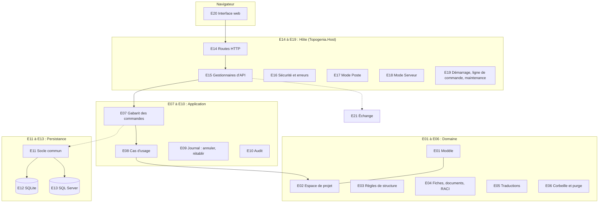

<!-- architecture-detaillee.md -->
<!-- Index pedagogique de chaque element de Topogenia 2.0 : role, emplacement, phases de construction et etat -->

# Topogenia 2.0 : les éléments et leurs phases

Ce document numérote chaque élément du logiciel (E01, E02...), dit à quoi il sert, où il se trouve, et dans quelles
phases il est construit. Il se lit après `architecture-simple.md` ; la référence technique complète reste
`architecture.md`, les tâches sont dans `plan.md`.

État au 29/10/2026 : phases 0 à 5 terminées, phase 6 en porte de contrôle (porte P6-T12).

**Légende des états** : **Fait** (construit et contrôlé par une porte) ; **En cours** (construit, porte en cours) ;
**À faire** ; **Squelette** (le dossier existe, le contenu viendra plus tard).

## 1. Les phases en bref

| Phase | Ce qu'elle produit | État |
|---|---|---|
| 0 Cadrage | La lecture de la spécification, la liste de tous les comportements à prouver (`couverture.md`), les questions | Fait |
| 1 Squelette | La solution, les projets vides, les règles d'architecture, la charte graphique, la maquette | Fait |
| 2 Domaine | Toutes les règles du métier, en mémoire, sans base | Fait |
| 3 Persistance | L'écriture et la lecture dans SQLite et SQL Server, les migrations, les vues des rapports | Fait |
| 4 Application et hôte | Les actions de bout en bout, l'annulation, l'API HTTP, les deux modes, la sécurité | Fait |
| 5 Échange | Les paquets `.topogenia` et les fichiers `.pmap` (import, export, aperçu) | Fait |
| 6 Interface | L'application web complète : accueil, carte, fiches, traductions, exports | En cours (porte P6-T12) |
| 7 Paquets et recette | Les livrables installables, la documentation d'exploitation, le rapport final | À faire |

Chaque phase se ferme par une **porte** : des contrôleurs indépendants vérifient le travail, et la phase suivante
ne commence qu'une fois la porte franchie.

## 2. Carte des éléments

## 3. Index des éléments

### Domaine (`src/Topogenia.Domain`) : les règles du métier

Il ne dépend de rien : ni base, ni réseau, ni horloge système. Il reçoit l'état d'un projet en mémoire et rend la
liste des changements.

| N° | Élément | Rôle (en clair) | Où | Phases | État |
|---|---|---|---|---|---|
| E01 | Modèle | Les objets du métier : projet, membre, carte, couloir, étape, flèche, fiche, document, irritant ; les valeurs (code d'étape, case, couleur) ; les codes d'erreur stables | `Model/`, `Values/`, `Errors/` | 2 | Fait |
| E02 | Espace de projet | Le projet chargé en mémoire ; à la fin d'une action, il calcule les changements « avant / après » qui servent à écrire et à annuler | `Workspace/` | 2 (révisé en 4) | Fait |
| E03 | Règles de structure | Une étape par case, couloirs, flèches, sous-cartes, sélection (coller, transférer, détailler), remontée d'une sous-carte | `Lanes/`, `Steps/`, `Flows/`, `Structure/`, `SubMaps/`, `Selection/`, `Blocks/`, `Dissolutions/`, `Layout/`, `Maps/` | 2 | Fait |
| E04 | Fiches, documents, RACI | Le contenu d'une étape (but, outils, déroulé, brouillon puis validation), les documents produits et utilisés, les irritants, qui fait quoi (R, A, C, I) | `Sheets/`, `Documents/`, `Raci/` | 2 | Fait |
| E05 | Traductions | Les textes saisis traduits par langue, à la main ou par classeur Excel | `Translations/` | 2 | Fait |
| E06 | Corbeille et purge | Suppression logique, restauration, effacement définitif après 30 jours | `Trash/` | 2 | Fait |
| E06b | Projets et membres | Création d'un projet, liste des membres, rôles (animateur, contributeur, lecteur) | `Projects/` | 2 (révisé en 4, AR-104) | Fait |

Le domaine et ses tests forment le **cœur fermé** (licence propriétaire, ADR 048) ; il sera livré en paquet
obscurci en phase 7 (P7-T04b).

### Application (`src/Topogenia.Application`) : le chef d'orchestre

| N° | Élément | Rôle (en clair) | Où | Phases | État |
|---|---|---|---|---|---|
| E07 | Gabarit des commandes | Le trajet unique de toute action : droits, verrou du projet, chargement, contrôle de version, règle du domaine, écriture, journal, réponse | `Commands/`, `Authorization/` | 4 | Fait |
| E08 | Cas d'usage | Une classe par action ou lecture (créer un projet, ajouter une étape, valider une fiche...), rangées par fonctionnalité | `Projects/`, `Members/`, `Maps/`, `Lanes/`, `Steps/`, `Flows/`, `Selection/`, `Dissolutions/`, `Sheets/`, `Documents/`, `Raci/`, `Translations/`, `Trash/`, `Profile/`, `Queries/` | 4 | Fait |
| E09 | Journal des opérations | Annuler et rétablir (50 actions par utilisateur et par carte), refus si quelqu'un a modifié la même chose depuis | `OperationLog/` | 4 | Fait |
| E10 | Audit et maintenance | Trace des actions sensibles, purge quotidienne de la corbeille et de l'audit ancien | `Audit/`, `Maintenance/` | 4 | Fait |
| E10b | Ports | Les interfaces que l'application demande au monde extérieur (base, annuaire, horloge) ; la persistance et l'hôte les fournissent | `Ports/` | 4 | Fait |

### Persistance (`src/Topogenia.Persistence*`) : la mémoire

| N° | Élément | Rôle (en clair) | Où | Phases | État |
|---|---|---|---|---|---|
| E11 | Socle commun | Le modèle de base de données (une seule description pour les deux moteurs), le chargement et l'écriture d'un projet, les contraintes, la traduction des erreurs du moteur | `Topogenia.Persistence/` | 3 (complété en 4) | Fait |
| E12 | SQLite (mode Poste) | Le fichier de données, ses réglages, ses sauvegardes et la restauration qui garde le fichier remplacé | `Topogenia.Persistence.Sqlite/` | 3 (complété en 4, AR-96) | Fait |
| E13 | SQL Server (mode Serveur) | Les migrations, les rôles `topogenia_app` et `topogenia_bi`, les vues `bi` lues par Power BI | `Topogenia.Persistence.SqlServer/` | 3 (dixième migration en 4) | Fait |

### Hôte (`src/Topogenia.Host`) : le guichet

| N° | Élément | Rôle (en clair) | Où | Phases | État |
|---|---|---|---|---|---|
| E14 | Routes HTTP | La liste des adresses de l'API (une soixantaine, reprises de la 1.x) ; aucune règle dedans | `Endpoints/` | 4 | Fait |
| E15 | Gestionnaires d'API | Transforment une requête en commande, et une réponse en JSON | `Api/`, `Json/` | 4 | Fait |
| E16 | Sécurité et erreurs | En-têtes de sécurité, garde anti-CSRF, limite de taille, HTTPS ; toute erreur rendue en `{code, message, details}` dans la langue de l'utilisateur | `Security/`, `Errors/`, `Users/` | 4 | Fait |
| E17 | Mode Poste | Écoute locale seulement, jeton de lancement, fichier de données, sauvegarde et restauration proposée | `Desktop/` | 4 (paquet en 7) | Fait |
| E18 | Mode Serveur | Compte Windows, HTTPS et HSTS, base contrôlée au démarrage, administrateurs déclarés | `Server/` | 4 (paquet en 7) | Fait |
| E19 | Démarrage, ligne de commande, maintenance | Contrôles avant la première requête, `--migrate` et `--check`, journal en fichier, purge quotidienne | `Startup/`, `Logging/`, `Maintenance/`, `Composition/` | 4 (`--export`, `--import` en 5) | Fait |

### Les autres éléments

| N° | Élément | Rôle (en clair) | Où | Phases | État |
|---|---|---|---|---|---|
| E20 | Interface web | L'application dans le navigateur : accueil, carte, ruban, fiches, traductions, exports | `web/` | 1 (charte et maquette), 6 | En cours (porte P6-T12) |
| E21 | Échange | Paquets `.topogenia` (un projet complet, avec empreintes) et fichiers `.pmap` 1.1 (structure et fiches, captés d'un récit) | `src/Topogenia.Interchange` | 5 | Fait |
| E22 | Tests | Un projet de tests par couche, plus les règles d'architecture ; les tests de données tournent sur les deux moteurs | `tests/` | 1 à 7 | En cours |
| E23 | Construction et intégration continue | Versions centralisées, avertissements traités comme erreurs, CI GitHub écrite (non exécutée : pas de dépôt), notices tierces | `Directory.*.props`, `.github/`, `build/` | 1, 7 | Fait (phase 1) |
| E24 | Paquets livrés | ZIP du mode Poste (exécutable autonome), ZIP du mode Serveur (IIS), SBOM, empreintes, cœur fermé en paquet | (à créer) | 7 | À faire |
| E25 | Documentation | Spécification de suivi (`etat.md`, `journal.md`, `plan.md`, `couverture.md`), décisions (ADR et AR), recette pour le porteur du projet | `docs/` | 0 à 7 | En cours |

## 4. Qui dépend de qui

| Élément | Peut utiliser | Ne doit jamais utiliser |
|---|---|---|
| Domaine (E01 à E06) | rien | la base, le web, les fichiers, l'horloge système |
| Application (E07 à E10) | le domaine, ses propres ports | EF Core, HTTP |
| Persistance (E11 à E13) | le domaine, l'application (pour ses ports) | HTTP |
| Échange (E21) | le domaine, l'application | HTTP, la base |
| Hôte (E14 à E19) | tout ce qui précède | du SQL écrit à la main |

Ces interdits ne sont pas une convention : `tests/Topogenia.Architecture.Tests` les vérifie à chaque compilation
(environ 720 tests), et une porte de contrôle les réexamine à chaque phase.

## 5. Pour aller plus loin

| Je veux comprendre... | Lire |
|---|---|
| le détail technique d'une couche | `architecture.md` |
| pourquoi un choix a été fait | `decisions/README.md` (ADR), `decisions/000-arbitrages-phase-0.md` (AR) |
| ce qui reste à faire | `plan.md`, `etat.md` |
| quel test prouve quel comportement | `couverture.md` |
| ce qui a été volontairement remis à la fin | `a-peaufiner.md` |
