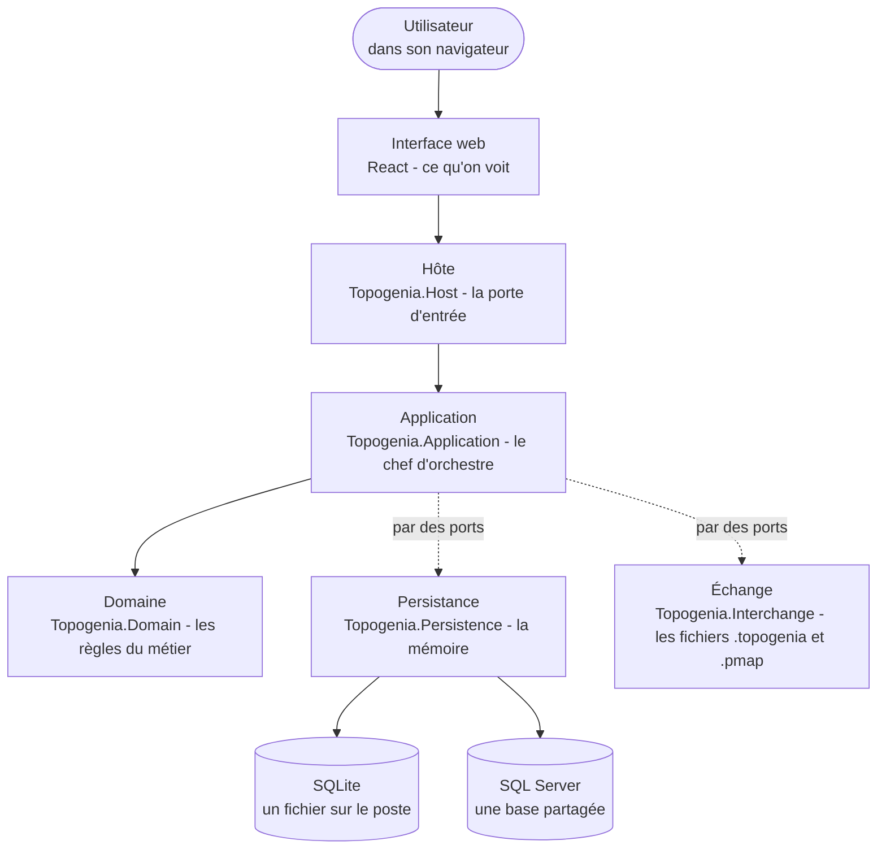
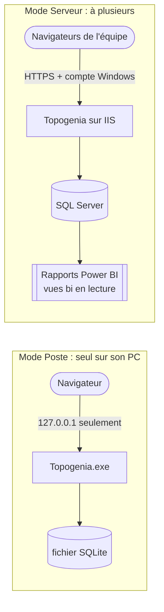
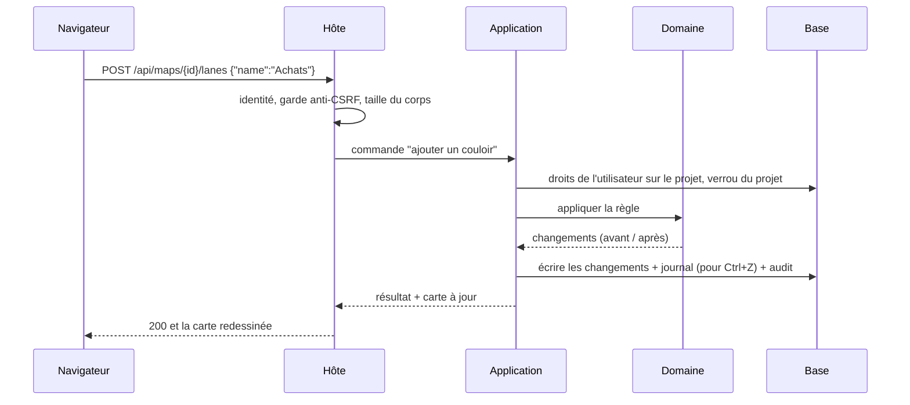
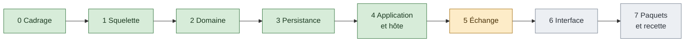

<!-- architecture-simple.md -->
<!-- Vue d'ensemble pedagogique de l'architecture de Topogenia 2.0, en une page, avec schemas -->

# Topogenia 2.0 en une page

Topogenia sert à **dessiner des processus en couloirs** à plusieurs : chaque couloir est un acteur, chaque case
une étape, chaque flèche un enchaînement ; une étape peut s'ouvrir sur une sous-carte et porter une fiche.

Pour aller plus loin : `architecture-detaillee.md` (chaque élément, son rôle et sa phase de construction), puis
`architecture.md` (la référence technique complète).

## 1. Le principe : des couches qui ne se parlent que dans un sens

Une règle simple, vérifiée par des tests à chaque compilation : **une couche ne connaît que celle du dessous**.
Le domaine, au centre, ne connaît personne : ni la base, ni le web. On peut donc changer de base ou d'écran
sans toucher aux règles du métier.

| Couche | Son rôle, en une phrase | Image |
|---|---|---|
| Interface web | Afficher la carte et transmettre les gestes de l'utilisateur | la vitrine |
| Hôte | Recevoir les requêtes, vérifier qui parle et qu'il en a le droit, répondre | le guichet |
| Application | Dérouler chaque action toujours dans le même ordre (droits, verrou, règles, écriture, journal) | le chef d'orchestre |
| Domaine | Dire ce qui est permis : une étape par case, un seul animateur au moins, etc. | le règlement |
| Persistance | Lire et écrire dans la base, la même chose sur les deux moteurs | la mémoire |
| Échange | Lire et écrire les fichiers d'import et d'export | la poste |

## 2. Deux façons de s'en servir

Le **même code** sert les deux modes ; seuls changent l'écoute, l'authentification et la base.

## 3. Le trajet d'une action

Exemple : l'utilisateur ajoute un couloir « Achats ».

Toutes les actions suivent ce même trajet : c'est ce qui rend le comportement prévisible et les droits
impossibles à oublier.

## 4. Cinq idées à retenir

1. **Le domaine est pur** : il calcule les changements en mémoire, sans base ni réseau ; il se teste vite et seul.
2. **Un seul gabarit pour toutes les actions** : droits, verrou, règles, écriture, journal, toujours dans cet ordre.
3. **Annuler et rétablir côté serveur** : chaque action garde ses changements « avant / après » ; Ctrl+Z les rejoue
   à l'envers, et refuse si quelqu'un a modifié la même chose entre-temps.
4. **Deux moteurs, un seul comportement** : chaque test de données tourne sur SQLite **et** sur SQL Server.
5. **Sécurité par défaut** : écoute locale en mode Poste, HTTPS et compte Windows en mode Serveur, contrôle de
   version (`If-Match`) sur toute modification, aucune donnée sensible dans les journaux.

## 5. Où en est la construction

Vert : terminé ; orange : en cours (phase 5, l'export du paquet est fait) ; gris : à faire. Le détail par élément est
dans `architecture-detaillee.md`.
